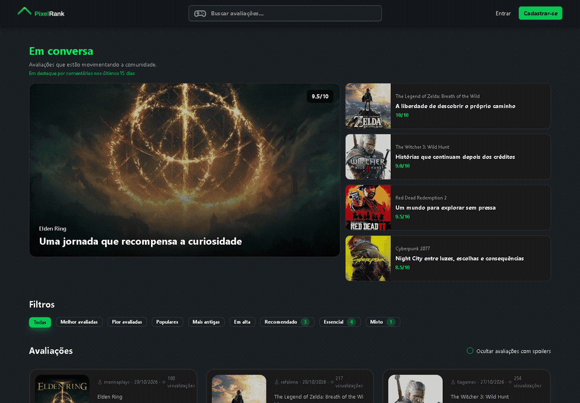
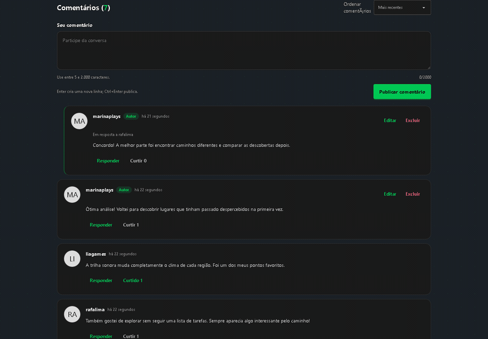
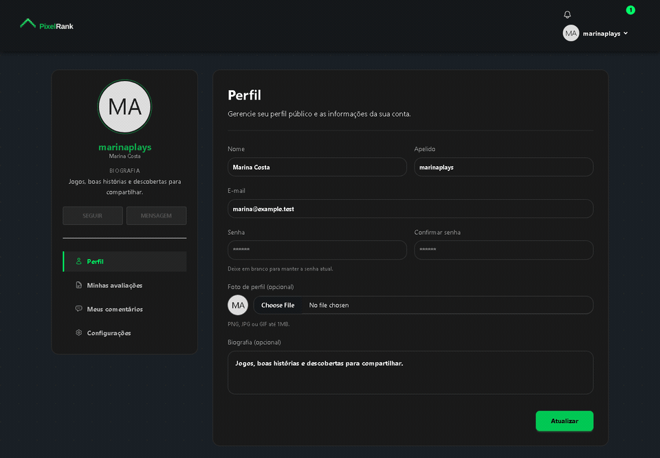
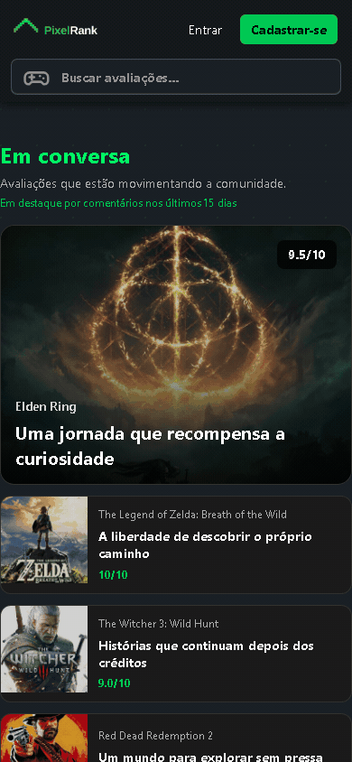

# PixelRank

Projeto de estudo e portfólio inspirado na proposta do Letterboxd, voltado a avaliações de jogos. Sem vínculo, associação ou endosso dos jogos e marcas citados. Código sob [licença MIT](LICENSE).

O PixelRank reúne resenhas da comunidade com notas de 0 a 10, recomendações, prós e contras e aviso de spoilers. A aplicação inclui feed com filtros e destaques, busca de jogos pelo IGDB, comentários com respostas e curtidas, notificações e um painel para gerenciar perfil, avaliações, comentários e configurações. A interface usa Laravel com Blade, em português brasileiro e inglês.

## Demonstrações

Gravações reais da aplicação com dados fictícios em um banco SQLite temporário isolado. As contas usadas nas capturas já estavam verificadas. A integração Twitch/IGDB estava desativada: o formulário de criação é apresentado, mas a publicação de uma nova avaliação depende da seleção de um jogo pela API.

### Comunidade



### Comentários e interações



### Meu painel



### Comunidade no celular



## Screenshots

Capturas reais em português, com dados fictícios no mesmo ambiente isolado das demonstrações. Desktop em 1440 × 1000 e celular em 390 × 844.

As capas dos jogos são carregadas do IGDB e pertencem aos respectivos titulares. Os passos para repetir as capturas estão em [docs/demo/README.md](docs/demo/README.md).

| Tela | Desktop | Celular |
| --- | --- | --- |
| Home | [Ver captura](docs/screenshots/home-desktop.png) | [Ver captura](docs/screenshots/home-mobile.png) |
| Avaliação | [Ver captura](docs/screenshots/avaliacao-desktop.png) | [Ver captura](docs/screenshots/avaliacao-mobile.png) |
| Comentários | [Ver captura](docs/screenshots/comentarios-desktop.png) | [Ver captura](docs/screenshots/comentarios-mobile.png) |
| Login | [Ver captura](docs/screenshots/login-desktop.png) | — |
| Cadastro | [Ver captura](docs/screenshots/cadastro-desktop.png) | — |
| Meu painel: perfil | [Ver captura](docs/screenshots/dashboard-perfil-desktop.png) | — |
| Meu painel: avaliações | [Ver captura](docs/screenshots/dashboard-avaliacoes-desktop.png) | — |
| Meu painel: comentários | [Ver captura](docs/screenshots/dashboard-comentarios-desktop.png) | — |
| Meu painel: configurações | [Ver captura](docs/screenshots/dashboard-configuracoes-desktop.png) | — |
| Notificações | [Ver captura](docs/screenshots/notificacoes-desktop.png) | — |
| Criar avaliação | [Ver captura](docs/screenshots/criar-avaliacao-desktop.png) | — |

## Estrutura e stack

Versões registradas em `composer.lock` e `package-lock.json`:

- **Backend:** Laravel 13.38.0, Eloquent, sessões por cookie, Form Requests e Policies.
- **Interface:** Blade, Tailwind CSS 4.3.2, DaisyUI 5.6.18, Alpine.js 3.15.12 e Vite 8.1.4.
- **Banco:** MySQL por padrão; SQLite como alternativa local e em memória nos testes.
- **Testes:** Pest 4.7.5 e PHPUnit 12.5.30.
- `app/`: controllers, validações, regras de acesso, models, ações, serviço IGDB, notificações e job de boas-vindas.
- `resources/views/`, `resources/css/` e `resources/js/`: telas, componentes e recursos da interface.
- `routes/web.php`: rotas da aplicação; `lang/pt_BR/` e `lang/en/`: traduções.
- `database/`: migrations, factories e seeders; `tests/`: testes automatizados.
- [docs/STATUS.md](docs/STATUS.md): acompanhamento do projeto.

## Executar localmente

Requisitos: **PHP 8.4.1 ou superior**, Composer 2, Node.js/npm e Git. O Vite 8.1.4 aceita Node `^20.19.0 || >=22.12.0`. Habilite as extensões exigidas pelo Composer e o driver PDO do banco escolhido; os testes precisam de PDO SQLite.

Embora `composer.json` declare PHP `^8.3`, as versões Symfony registradas no lock exigem PHP `>=8.4.1`. Use esse requisito para instalar as dependências sem alterar o lock.

### Projeto já configurado

Com `.env`, chave, dependências e banco preparados, execute na raiz:

```powershell
composer run dev
```

O comando inicia o servidor Laravel, o processo de fila e o Vite. Mantenha o terminal aberto e acesse [http://localhost:8000](http://localhost:8000). Para encerrar, pressione `Ctrl+C`.

Também é possível iniciar os serviços separadamente, um comando em cada terminal:

```powershell
php artisan serve --host=localhost --port=8000
```

```powershell
npm.cmd run dev
```

```powershell
php artisan queue:work
```

O navegador acessa a porta do Laravel; o Vite fornece os recursos durante o desenvolvimento. Preserve um `.env` já configurado e sua `APP_KEY`.

### Primeira instalação

No PowerShell:

```powershell
git clone https://github.com/GuilhermeZalla/pixel-rank-app.git
cd pixel-rank-app
composer install
npm.cmd ci
Copy-Item .env.example .env
php artisan key:generate
php artisan storage:link
```

A cópia do ambiente e a geração de chave são passos de uma instalação nova. `storage:link` permite servir os avatares gravados no disco público.

O `.env.example` usa MySQL. Crie um banco vazio antes das migrations:

```sql
CREATE DATABASE pixel_rank_app CHARACTER SET utf8mb4 COLLATE utf8mb4_unicode_ci;
```

Ajuste `DB_HOST`, `DB_PORT`, `DB_DATABASE`, `DB_USERNAME` e `DB_PASSWORD` no `.env`. Para identificar o projeto, você também pode definir `APP_NAME=PixelRank` e `APP_URL=http://localhost:8000`. Depois:

```powershell
php artisan migrate --seed
composer run dev
```

O seeder cria **cinco usuários fictícios**, de quatro a oito avaliações por usuário e de dois a vinte comentários por avaliação. As quantidades variam a cada execução. Os usuários gerados têm e-mail verificado e a senha de factory `password`, destinada apenas a dados locais de demonstração. **Não existe uma conta fixa `test@example.com`.** Para testar o cadastro normal, crie sua própria conta e confirme o e-mail.

O seeder acrescenta registros a cada execução; use-o em um banco novo para a primeira demonstração.

### Alternativa com SQLite

Para uma instalação local sem servidor MySQL, crie o arquivo na raiz do projeto:

```powershell
if (-not (Test-Path database/database.sqlite)) {
    New-Item -ItemType File -Path database/database.sqlite | Out-Null
}
```

Ajuste o `.env` com o caminho absoluto do arquivo, usando barras normais:

```dotenv
DB_CONNECTION=sqlite
DB_DATABASE=C:/caminho/para/pixel-rank-app/database/database.sqlite
```

Depois execute `php artisan config:clear`, `php artisan migrate --seed` e `composer run dev`. As tabelas de sessão, cache e fila são criadas pelas migrations do projeto.

## Autenticação e interface

Visitantes podem explorar o feed, pesquisar avaliações e ler resenhas e comentários. Cadastro e login usam sessão do Laravel. Publicar ou gerenciar avaliações, comentar, curtir comentários, acessar o painel e consultar notificações exige autenticação e e-mail verificado. A edição e a exclusão de avaliações, comentários e dados da conta são restritas ao proprietário.

As avaliações recebem nota de **0 a 10, em passos de 0,5**, recomendação (Essencial, Recomendado, Misto ou Não recomendado), plataforma, texto, prós e contras e marcação de spoiler. O feed permite ordenar por notas, visualizações, data e comentários recentes, além de filtrar por recomendação. Os destaques consideram os comentários dos últimos 15 dias; sem atividade recente, usam as avaliações mais visualizadas.

Os comentários permitem responder, curtir, editar e excluir as próprias mensagens, ordenar por mais novos ou mais antigos e carregar outros itens. O envio usa requisições assíncronas. O painel reúne as abas de perfil, avaliações, comentários e configurações, com upload de avatar, exportação JSON e exclusão de conta.

## Rotas principais

São rotas web da aplicação Blade, com sessão e proteção CSRF nas alterações. Algumas ações retornam JSON para a própria interface.

| Rota | Finalidade |
| --- | --- |
| `GET /` e `GET /{filter}` | Feed e filtros de recomendação ou ordenação |
| `GET /search/{filter?}/{search?}` | Busca de avaliações por título |
| `GET /games/search?query=...` | Busca de jogos no IGDB |
| `GET /reviews/{review}` | Avaliação e comentários |
| `GET /reviews/create` e `POST /reviews` | Formulário e publicação de avaliação |
| `GET /reviews/{review}/edit`, `PUT/DELETE /reviews/{review}` | Gerenciamento da própria avaliação |
| `GET /reviews/{review}/comments` | Comentários em JSON, com ordenação e paginação |
| `POST /comments`, `PATCH/DELETE /comments/{comment}` | Publicação, edição e exclusão de comentário |
| `PUT/DELETE /comments/{comment}/like` | Curtir ou remover a própria curtida |
| `GET /users/{user}/{menu?}/edit` | Painel do proprietário; abas `menu1` a `menu4` |
| `GET /users/{user}/export` e `DELETE /users/{user}` | Exportar dados e excluir a própria conta |
| `GET /notifications` | Notificações não lidas da conta |
| `PATCH /notifications/{id}/read` e `PATCH /notifications/read-all` | Marcar uma ou todas como lidas |
| `GET/POST /login`, `GET/POST /register` e `DELETE /logout` | Autenticação |
| `GET/POST /forgot-password`, `GET /reset-password/{token}` e `POST /reset-password` | Recuperação de senha |
| `GET /email/verify` e `POST /email/verification-notification` | Aviso de verificação e reenvio do link |
| `GET /email/verify/{id}/{hash}` | Verificação por link assinado |
| `POST /locale` e `PATCH /users/theme` | Preferências de idioma e tema |

## Idiomas, temas e dados

- **Português brasileiro e inglês:** a aplicação considera a escolha salva na sessão ou no cookie, o idioma do navegador e o padrão de `APP_LOCALE`. Datas, números e mensagens acompanham o idioma ativo.
- **Claro, escuro e sistema:** a preferência de tema é preservada no navegador e na conta autenticada.
- **Spoilers:** há aviso nas avaliações e controle para ocultá-las na listagem.
- **Exportação:** o painel baixa um JSON com os dados básicos do perfil, avaliações e comentários.
- **Exclusão:** a confirmação no painel remove a conta, suas avaliações, comentários e avatar.

## Fluxo de demonstração

1. Explore os destaques e aplique filtros no feed; abra uma avaliação e leia os comentários.
2. Crie uma conta, confirme o e-mail pelo link recebido e entre no painel.
3. Com Twitch/IGDB configurado, selecione um jogo e publique uma avaliação com nota, recomendação e texto.
4. Comente em uma avaliação, responda a outra mensagem e curta comentários.
5. Consulte os avisos no sino e em Notificações; gerencie suas publicações e preferências em Meu painel.

## Limites do projeto

- A seleção de jogos para publicar novas avaliações depende da API Twitch/IGDB. Sem credenciais ou com falha externa, o site continua exibindo o conteúdo já salvo e o formulário, mas a busca de jogos fica vazia e os metadados indisponíveis.
- Não há atualização por WebSocket das discussões ou do sino. As notificações são internas e aparecem ao carregar a interface.
- A opção de newsletter é uma preferência armazenada; não há envio periódico implementado.
- Perfis de outros usuários exigem login e e-mail verificado; a listagem geral de usuários está bloqueada por Policy.
- Os dados do seeder são fictícios e variáveis. Os GIFs usam um conjunto próprio de demonstração em banco isolado.
- O projeto não possui uma URL pública de produção documentada.
- Nas capturas, a capa da página individual de avaliação apresenta uma falha de renderização da URL; as capas da Home carregam normalmente. O problema está registrado em [docs/STATUS.md](docs/STATUS.md), e as mídias preservam o comportamento atual.

## API de jogos: Twitch/IGDB

A integração obtém um token OAuth pelo fluxo `client_credentials` da Twitch e consulta a API do IGDB. Configure no `.env`:

```dotenv
TWITCH_AUTH=https://id.twitch.tv/
TWITCH_CLIENT_ID=seu_client_id
TWITCH_CLIENT_SECRET=seu_client_secret
GAME_API_URL=https://api.igdb.com/v4
```

O serviço usa essas credenciais; `GAME_API_KEY`, ainda presente no arquivo de exemplo, não é utilizada na autenticação atual. Depois de alterar o ambiente, execute `php artisan config:clear` e reinicie os processos.

`GameApiService` centraliza o acesso externo, define timeout e novas tentativas, guarda o token em cache e retorna listas vazias em caso de indisponibilidade. A interface preserva a leitura das avaliações e informa a ausência dos dados. As capas de jogos selecionados pela integração usam o serviço de imagens do IGDB.

## E-mails, verificação e notificações

O `.env.example` usa **`MAIL_MAILER=log`**. Nesse modo, os e-mails são gravados em `storage/logs/laravel.log`; não chegam a uma caixa de entrada. Para entrega real, configure o transportador SMTP no ambiente.

| Evento | Como é processado |
| --- | --- |
| Boas-vindas após o cadastro | Job `NewUserNotification`, enfileirado na conexão configurada |
| Verificação de e-mail, reenvio e troca de endereço | Notificação de e-mail enviada na própria requisição |
| Recuperação de senha | Notificação de e-mail enviada na própria requisição |
| Comentário em uma avaliação ou resposta a um comentário | Notificação gravada diretamente no banco, sem worker |

### Fila de boas-vindas

Com `QUEUE_CONNECTION=database`, mantenha o worker ativo:

```powershell
php artisan queue:work
```

`composer run dev` já inicia um processo de fila com `queue:listen`. Se iniciar os serviços separadamente, o worker precisa de seu próprio terminal. Sem ele, o e-mail de boas-vindas permanece pendente; a verificação de e-mail e os avisos internos continuam seguindo os fluxos indicados na tabela.

Para consultar falhas, use `php artisan queue:failed`. Após corrigir a causa, `php artisan queue:retry <uuid>` reprocessa um job específico. Reinicie o worker após mudanças de código ou configuração.

### SMTP no ambiente local

Exemplo para um capturador SMTP local já iniciado, como Mailpit:

```dotenv
MAIL_MAILER=smtp
MAIL_SCHEME=null
MAIL_HOST=127.0.0.1
MAIL_PORT=1025
MAIL_USERNAME=null
MAIL_PASSWORD=null
MAIL_FROM_ADDRESS=pixelrank@example.test
MAIL_FROM_NAME="PixelRank"
```

Para outro provedor, ajuste host, porta, esquema e credenciais conforme o serviço. Execute `php artisan config:clear` e reinicie os processos depois da alteração.

### Links e limites

- Login e cadastro: cinco tentativas por minuto em cada endpoint; busca de jogos: 30 por minuto.
- Verificação: link assinado e usuário autenticado; confirmação e reenvio têm limite de seis requisições por minuto em cada endpoint. A troca de e-mail invalida a verificação anterior.
- Recuperação: solicitação e conclusão têm limite de cinco requisições por minuto em cada endpoint. O token expira em 60 minutos, com intervalo mínimo de 60 segundos para gerar outro. A solicitação apresenta a mesma mensagem para e-mails conhecidos e desconhecidos.
- Comentários: de cinco a 2.000 caracteres; respostas só podem apontar para comentários da mesma avaliação. Uma conta registra no máximo uma curtida por comentário.
- Avaliações: título de oito a 120 caracteres e texto com pelo menos 150; até dez prós e dez contras na validação do servidor.
- Avatares: JPG, JPEG, PNG ou GIF de até 1 MB.
- Notificações: a página lista somente as não lidas, em grupos de 20, com marcação individual ou conjunta.

## Verificação

Na raiz do projeto:

```powershell
php artisan test --compact
npm.cmd run build
php vendor/bin/pint --test
```

Os testes usam SQLite em memória, sessão e cache de teste, fila síncrona e transportador de e-mail em memória, conforme `phpunit.xml`. Cobrem autenticação e verificação de conta, permissões de proprietário, limites de requisições, dashboard, traduções, resiliência do IGDB, destaques e interações nos comentários.

A pasta `tests/Browser` contém atualmente um teste HTTP de cadastro e verificação executado pelo Laravel; não é uma suíte de automação visual em navegador. As capturas desta documentação complementam a demonstração da interface.

## Decisões técnicas

- **Laravel e Blade:** páginas renderizadas no servidor, com componentes reutilizáveis e Alpine.js nas interações da interface.
- **Sessões e Policies:** autenticação por cookie, proteção CSRF e autorização das alterações pelo proprietário do recurso.
- **Form Requests e validação:** regras de entrada centralizadas nos formulários principais e validação dos comentários no controller.
- **Integração isolada:** `GameApiService` concentra OAuth, cache e tratamento de falhas do serviço de jogos.
- **Criação transacional:** uma avaliação e seus prós e contras são gravados na mesma transação.
- **Comentários:** respostas vinculadas à mesma avaliação, curtidas únicas por usuário e paginação para carregar mais mensagens.
- **Traduções:** arquivos separados para `pt_BR` e `en`, com middleware de seleção de idioma e testes de paridade das chaves.
- **Fila pontual:** o job de boas-vindas usa fila; os demais envios e avisos internos seguem os canais descritos acima.
