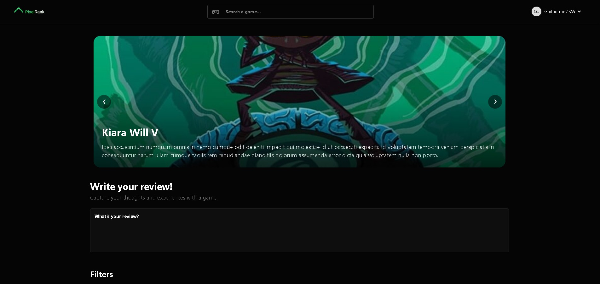
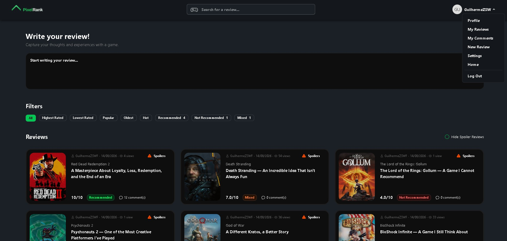
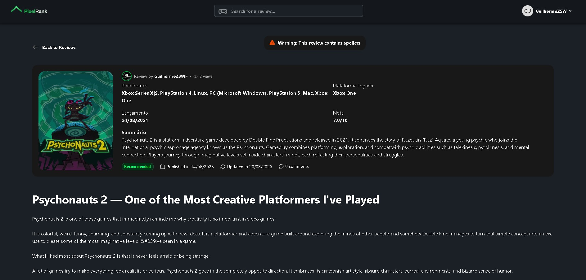
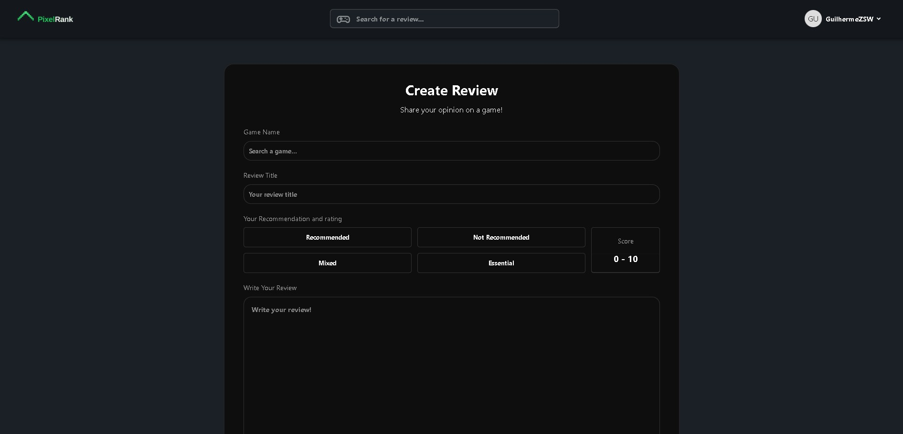
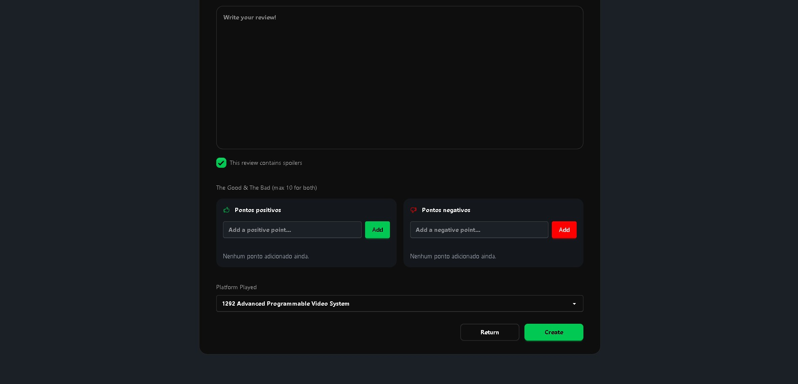
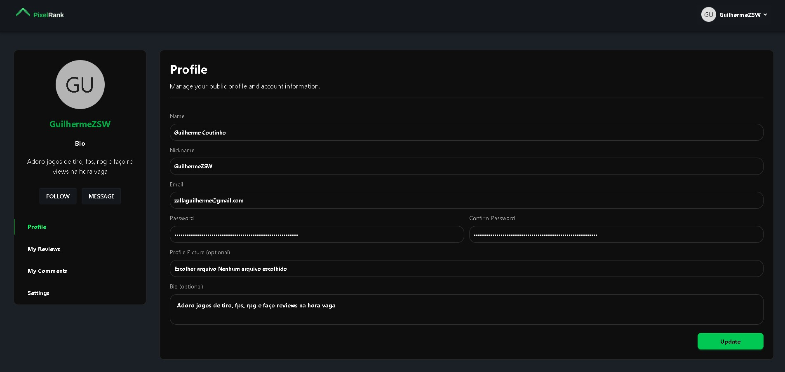
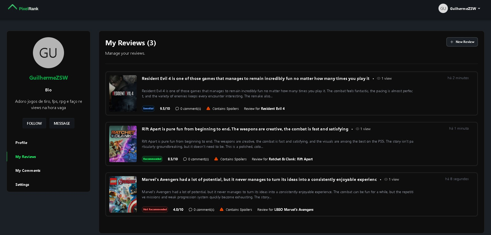
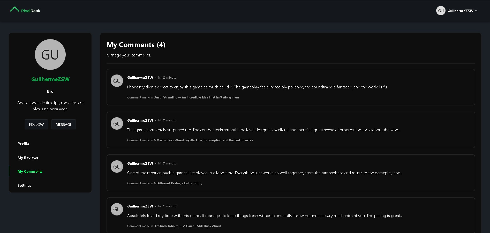
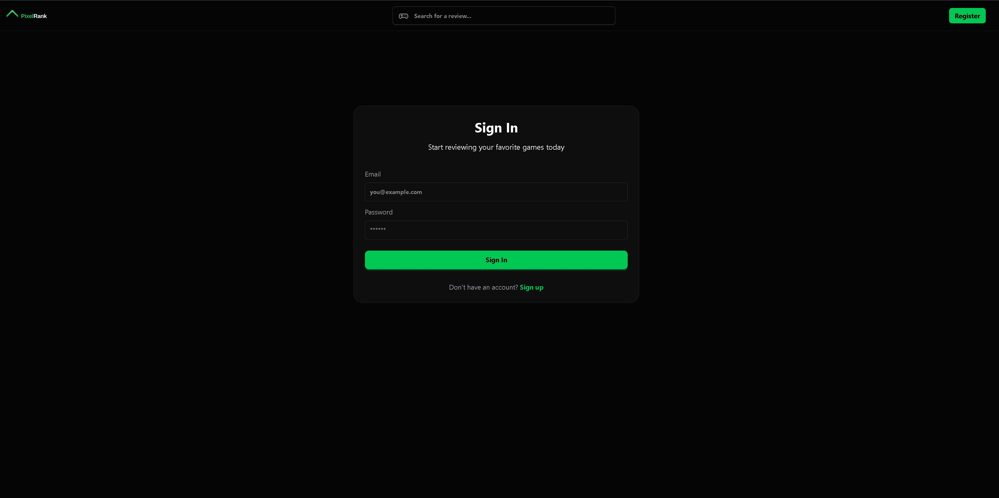
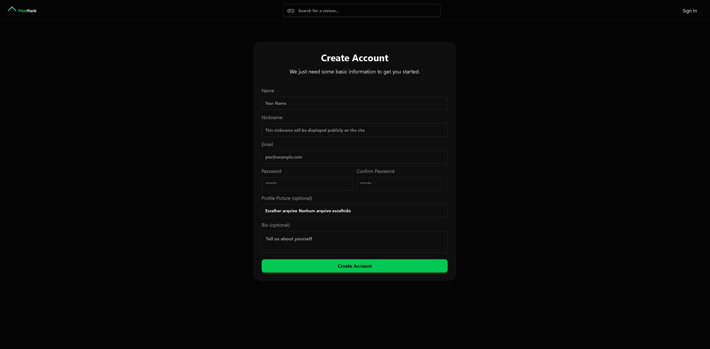

# PixelRank



O PixelRank é uma plataforma de avaliações de jogos inspirada na experiência do Letterboxd. Os usuários podem avaliar títulos com notas de 0 a 10, escrever resenhas detalhadas com indicação de prós e contras, comentar em publicações da comunidade, filtrar o feed e gerenciar seu perfil e histórico em um dashboard dedicado. É um projeto de portfólio desenvolvido com Laravel, Blade, Tailwind CSS, DaisyUI e Alpine.js.

## Features da aplicação

- Criar conta, autenticar-se, verificar e-mail e redefinir senha com segurança e proteção contra força bruta (rate limiting).
- Publicar, editar e excluir avaliações de jogos com nota, recomendação (Recomendado, Não recomendado, Misto ou Essencial), lista de prós e contras e aviso opcional de spoiler.
- Buscar jogos em tempo real com integração à API do IGDB/Twitch (capas, plataformas, sinopse e data de lançamento), contando com degradação graciosa quando a API externa não estiver configurada.
- Explorar o feed da comunidade com filtros rápidos (populares, mais bem avaliados, menores notas, mais antigos, quentes e por recomendação) e alternância para ocultar spoilers.
- Comentar nas avaliações e acompanhar as discussões em tempo real.
- Painel pessoal do usuário (Dashboard) organizado em abas: edição de perfil (dados, foto de avatar e bio), listagem das próprias avaliações e histórico de comentários.
- Internacionalização completa em Português (Brasil) e Inglês (EUA), com alternância de idioma salva na sessão e em cookie.
- Notificações in-app (sininho no header) para comentários nas suas avaliações e respostas aos seus comentários, com painel dedicado e opção de newsletter.
- Exportação de dados em JSON (perfil, avaliações e comentários) e exclusão de conta com confirmação.
- Tema claro/escuro/sistema com persistência da preferência.

## Tecnologias

- PHP 8.4.27 e Laravel 13
- Blade, Tailwind CSS 4 e DaisyUI 5
- Alpine.js 3 e Vite 8
- Pest 4 para os testes automatizados
- MySQL por padrão; SQLite em memória para os testes automatizados ou para desenvolvimento local simplificado
- Integração resiliente com a API Twitch / IGDB com cache de credenciais OAuth

## Rodar na sua máquina

Você precisa de PHP 8.4 com as extensões do Laravel, Composer, Node.js/npm e Git. Com SQLite, não é necessário instalar um servidor de banco de dados externo.

```bash
git clone https://github.com/GuilhermeZalla/pixel-rank-app.git
cd pixel-rank-app
composer install
npm install
```

Copie `.env.example` para `.env` (no PowerShell, use `Copy-Item .env.example .env`), gere a chave e prepare o banco:

```bash
php artisan key:generate
php artisan migrate --seed
```

O arquivo `.env.example` vem pré-configurado para MySQL. Para usar SQLite no ambiente local sem instalar MySQL, defina `DB_CONNECTION=sqlite` no `.env`, comente as outras variáveis `DB_*` e crie o arquivo antes de migrar (`type nul > database/database.sqlite` no Windows ou `touch database/database.sqlite` no Linux/Mac).

Se preferir MySQL, crie o banco antes de migrar:

```sql
CREATE DATABASE pixel_rank_app CHARACTER SET utf8mb4 COLLATE utf8mb4_unicode_ci;
```

O comando `php artisan migrate --seed` executa as migrations e popula o banco com dados padrão: aproximadamente 30 avaliações de exemplo e 10 comentários em cada uma, gerados via seeder, para você visualizar o funcionamento da aplicação imediatamente.

*(Opcional)* Se quiser exibir metadados reais da API de jogos (Twitch/IGDB), preencha no `.env` as variáveis `TWITCH_CLIENT_ID`, `TWITCH_CLIENT_SECRET`, `GAME_API_URL` e `GAME_API_KEY`. Se deixar em branco, o site funcionará normalmente em modo degradado, sem erros.

Inicie a aplicação e o Vite:

```bash
composer run dev
```

Abra [http://localhost:8000](http://localhost:8000). O seeder cria uma conta de teste inicial `test@example.com` (senha `password`).

## Notificações in-app

Quando outro usuário comenta na sua avaliação ou responde ao seu comentário, uma notificação é criada. Você pode acessá-las pelo ícone de sino no cabeçalho (com contador de não lidas) ou pela rota `/notifications`. Cada notificação pode ser marcada como lida individualmente ou todas de uma vez.

## Tema (claro/escuro/sistema)

Você pode escolher entre três opções de tema no menu do usuário no cabeçalho:
- **Sistema**: segue a preferência do seu navegador/sistema operacional.
- **Claro**: interface com fundo claro (tema `pixelrank-light`).
- **Escuro**: interface com fundo escuro (tema `pixelrank`, o padrão).

A escolha é salva no seu cookie, localStorage e, se estiver autenticado, no banco de dados.

## Exportação e exclusão de dados

No dashboard, na aba Configurações (menu4), na seção Dados, você pode:
- Exportar todos os seus dados (perfil, avaliações e comentários) em formato JSON.
- Deletar sua conta permanentemente, com confirmação e exclusão em cascata de todos os seus dados.

## API de jogos (Twitch/IGDB)

O projeto foi projetado para **degradar graciosamente** quando a API externa não está configurada:

- Sem credenciais Twitch/IGDB → as páginas de avaliação carregam normalmente, mostrando "Não disponível" onde o metadado do jogo iria.
- Busca de jogos retorna lista vazia (HTTP 200), sem erro 500.

Se quiser dados reais de jogos, preencha no `.env`:

```
TWITCH_AUTH=https://id.twitch.tv/
TWITCH_CLIENT_ID=seu_client_id
TWITCH_CLIENT_SECRET=seu_client_secret
GAME_API_URL=https://api.igdb.com/v4
GAME_API_KEY=sua_api_key
```

Se deixar em branco, o site funcionará normalmente em modo degradado, sem erros.

## Comandos úteis

| Comando | Para quê |
|---------|----------|
| `php artisan serve` | Inicia o servidor local |
| `php artisan migrate` | Cria as tabelas do banco |
| `php artisan migrate --seed` | Cria as tabelas e popula com dados de exemplo |
| `php artisan test` | Roda todos os testes |
| `php artisan queue:work` | Processa jobs enfileirados (ex: email de boas-vindas) |
| `php vendor/bin/pint --test` | Verifica formatação do código |

## Troubleshooting

### E-mail de verificação não chega

O `.env` vem com `MAIL_MAILER=log`. Com essa configuração, o Laravel **não envia email de verdade** — ele apenas grava o conteúdo do email no arquivo de log (`storage/logs/laravel.log`). Por isso você não recebe nada na caixa de entrada.

Para receber emails de verdade, configure um SMTP real no `.env`, por exemplo:

```
MAIL_MAILER=smtp
MAIL_HOST=smtp.mailtrap.io
MAIL_PORT=2525
MAIL_USERNAME=seu_usuario
MAIL_PASSWORD=sua_senha
MAIL_FROM_ADDRESS="noreply@seudominio.com"
MAIL_FROM_NAME="PixelRank"
```

Ou use um serviço como Mailtrap (desenvolvimento), SendGrid, AWS SES, etc.

A rota de reenvio de verificação já existe (`POST /email/verification-notification`) e funciona — o que falta é apenas configurar um transportador de email real.

### Jobs/Queue

O projeto tem um sistema de jobs/queue limitado:

| Job | Quando é disparado | O que faz |
|-----|-------------------|-----------|
| `NewUserNotification` | Após cadastro de usuário | Envia email de boas-vindas e grava log |
| `VerifyEmailNotification` | Cadastro / troca de email | Envia email de verificação de conta |

O `NewUserNotification` implementa `ShouldQueue`, ou seja, é enfileirado. A conexão de queue configurada é `database` (tabela `jobs`). Para os jobs serem executados, você precisa rodar o worker:

```bash
php artisan queue:work
```

Se não rodar o worker, os jobs ficam pendentes na tabela `jobs` e nunca são processados.

## Rodar as verificações

```bash
php artisan test
npm run build
php vendor/bin/pint --test
```

A suíte conta com 64 testes automatizados em Pest cobrindo autenticação, autorização via Policies, rate limiting, paridade de idiomas (PT-BR/EN-US), resiliência da API de jogos e as telas do dashboard.

## Como o app é organizado

As rotas ficam em `routes/` e encaminham as requisições para controllers em `app/Http/Controllers/`. As validações de entrada ficam em Form Requests e as permissões por usuário ficam em Policies. Models e migrations representam os dados no banco. Serviços como `GameApiService` isolam a comunicação externa com APIs e gerenciam falhas de rede de forma segura.

As views Blade ficam em `resources/views/`, divididas entre telas principais (`reviews/`, `users/`, `auth/`) e componentes reutilizáveis em `resources/views/components/`. A estilização usa Tailwind CSS e DaisyUI, enquanto micro-interações como abas do dashboard e alertas utilizam Alpine.js. A internacionalização completa em PT-BR/EN-US fica em `lang/`, com middleware para controle de sessão/cookie. Notificações e e-mails usam Jobs e Mailables.

## Demonstração

### Tela Inicial


### Menu e Navegação



### Avaliação



### Criação de Avaliação





### Dashboard







### Login e Cadastro





## Deploy

Para rodar em ambiente de produção, configure as variáveis essenciais no `.env` (`APP_ENV=production`, `APP_DEBUG=false`, `APP_URL=https://seudominio.com`, `SESSION_SECURE_COOKIE=true`). Execute os comandos de cache (`php artisan config:cache`, `php artisan route:cache`, `php artisan view:cache`, `php artisan storage:link`) e mantenha os workers de fila e agendador ativos (`php artisan queue:work` e `php artisan schedule:work`).

O app ainda não possui uma URL pública de produção.
